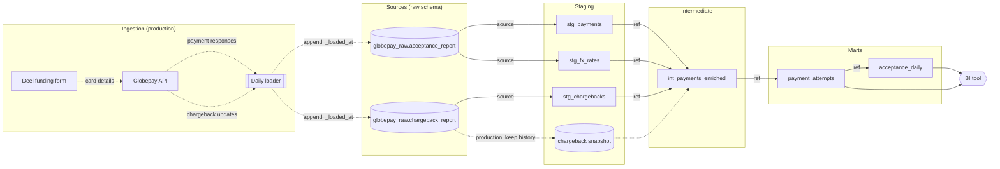

# Data model

Diagrams for the dbt project in `dbt/`. Column descriptions and tests are in the model YAML files. Rendered versions: `figures/13_dbt_lineage.png` and `figures/14_dbt_erd.png`.

## Lineage



`source` / `ref` arrows are built by dbt in this repo, one per `{{ source() }}` or `{{ ref() }}` call in the SQL. Dotted arrows (ingestion, chargeback snapshot) are the production design. The marts feed BI.

## Entity-relationship diagram

```mermaid
erDiagram
    direction LR
    ACCEPTANCE_REPORT ||--|| STG_PAYMENTS : "cleaned"
    ACCEPTANCE_REPORT ||--|{ STG_FX_RATES : "rates unpacked"
    CHARGEBACK_REPORT ||--|| STG_CHARGEBACKS : "cleaned"
    STG_PAYMENTS ||--|| INT_PAYMENTS_ENRICHED : "payment_id"
    STG_CHARGEBACKS ||--o| INT_PAYMENTS_ENRICHED : "payment_id"
    STG_FX_RATES }|--|| INT_PAYMENTS_ENRICHED : "payment_id, currency_code"
    INT_PAYMENTS_ENRICHED ||--|| PAYMENT_ATTEMPTS : "published"
    PAYMENT_ATTEMPTS }|--|| ACCEPTANCE_DAILY : "aggregated into"

    ACCEPTANCE_REPORT["globepay_raw.acceptance_report"] {
        varchar external_ref PK
        boolean status
        varchar source
        varchar ref
        timestamptz date_time
        varchar state
        boolean cvv_provided
        double amount
        varchar country
        varchar currency
        varchar rates
    }

    CHARGEBACK_REPORT["globepay_raw.chargeback_report"] {
        varchar external_ref PK
        boolean status
        varchar source
        boolean chargeback
    }

    STG_PAYMENTS["stg_payments"] {
        varchar payment_id PK
        varchar provider_ref
        timestamp attempted_at_utc
        date attempt_date
        varchar state
        boolean is_accepted
        boolean cvv_provided
        decimal(18,2) amount_local
        varchar currency_code
        varchar country_code
    }

    STG_CHARGEBACKS["stg_chargebacks"] {
        varchar payment_id PK
        boolean is_chargeback
    }

    STG_FX_RATES["stg_fx_rates"] {
        varchar payment_id PK
        varchar currency_code PK
        date rate_date
        double units_per_usd
    }

    INT_PAYMENTS_ENRICHED["int_payments_enriched"] {
        varchar payment_id PK
        varchar provider_ref
        timestamp attempted_at_utc
        date attempt_date
        date attempt_month
        varchar country_code
        varchar currency_code
        boolean is_usd_currency
        varchar state
        boolean is_accepted
        boolean is_declined
        boolean cvv_provided
        decimal(18,2) amount_local
        double fx_rate_to_usd
        decimal(18,6) amount_usd
        boolean has_fx_rate
        boolean is_chargeback
        boolean has_chargeback_record
        boolean is_chargeback_data_reliable
        boolean is_negative_amount
    }

    PAYMENT_ATTEMPTS["payment_attempts"] {
        varchar payment_id PK
        varchar provider_ref
        timestamp attempted_at_utc
        date attempt_date
        date attempt_month
        varchar country_code
        varchar currency_code
        boolean is_usd_currency
        varchar state
        boolean is_accepted
        boolean is_declined
        boolean cvv_provided
        decimal(18,2) amount_local
        double fx_rate_to_usd
        decimal(18,6) amount_usd
        decimal(18,6) accepted_amount_usd
        decimal(18,6) declined_amount_usd
        boolean is_chargeback
        boolean is_chargeback_data_reliable
        boolean is_negative_amount
        timestamp dbt_loaded_at
    }

    ACCEPTANCE_DAILY["acceptance_daily"] {
        date attempt_date PK
        varchar country_code PK
        varchar currency_code PK
        bigint total_attempts
        bigint accepted_attempts
        bigint declined_attempts
        decimal(18,2) total_amount_usd
        decimal(18,2) accepted_amount_usd
        decimal(18,2) declined_amount_usd
        bigint chargebacks
        bigint cvv_provided_attempts
    }
```

PK marks each table's grain (one key across several columns for `stg_fx_rates` and `acceptance_daily`). Every table shares one ID, `payment_id` (`external_ref` trimmed and renamed in staging).
